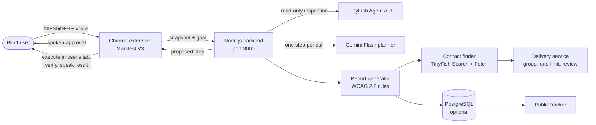

# Blindfold: Rescue and Report

**Rescue the user today. Fix the website for tomorrow.**

Blindfold is a voice-first Chrome extension and Node.js backend for blind and low-vision people who get stuck on inaccessible websites. It does two jobs in one flow:

1. **Rescue.** When a user is stuck, Blindfold looks at the page, works out the next step, asks for a spoken "yes", performs that single step in the user's own browser tab, checks that it worked, and reads the result aloud.
2. **Report.** If the user agrees, the barrier is turned into an anonymous, WCAG-mapped report with a concrete developer fix. Blindfold finds the right contact for the website, groups repeat problems into one email, and tracks the issue until it is fixed.


---

## Table of contents

- [The problem](#the-problem)
- [How it works](#how-it-works)
- [Safety and privacy](#safety-and-privacy)
- [Architecture](#architecture)
- [Repository layout](#repository-layout)
- [Getting started](#getting-started)
- [Configuration](#configuration)
- [Backend API](#backend-api)
- [The reporting pipeline](#the-reporting-pipeline)
- [Demo site](#demo-site)
- [Testing](#testing)
- [Current status and known limitations](#current-status-and-known-limitations)
- [Roadmap](#roadmap)
- [Sustainability](#sustainability)
- [Team](#team)

---

## The problem

A blind user opens a train booking page. The date field is read-only, the calendar button has no accessible name, and the calendar itself only responds to a mouse. The screen reader says "Edit text, read only" and then just "Button". The task is now impossible without a sighted helper.

Then nothing happens. The website never finds out. The user has no time or means to report it, and nobody is counting. The same broken control blocks the next person, and the one after that.

The 2026 WebAIM Million report found automatically detectable WCAG failures on 95.9% of the top one million home pages, so this is not an edge case.

Existing tools each cover only part of it:

- A screen reader cannot repair a broken control.
- Accessibility scanners list generic issues, not the place where a real person actually got stuck.
- Overlays and AI browser agents help once and never touch the source of the problem.

Blindfold connects the two halves: the person who is stuck right now, and the team that can fix the page.

|                                   | Screen reader | Scanners | AI browser agents | Blindfold |
|-----------------------------------|:-------------:|:--------:|:-----------------:|:---------:|
| Helps the user right now          | no            | no       | yes               | yes       |
| Evidence from a real person       | no            | no       | no                | yes       |
| User approves every action        | n/a           | n/a      | partly            | yes       |
| Tells the website, with a fix     | no            | partly   | no                | yes       |
| Tracks the problem until fixed    | no            | no       | no                | yes       |

---

## How it works

### Rescue (live, in the user's own tab)

1. The user presses **Alt+Shift+H** and says their goal ("select 15 November"), or types it if speech is not an option.
2. The extension captures a snapshot of the stuck spot: the nearby accessibility tree, the focused element, and safe values already on the page. Password, OTP and payment fields are never read.
3. In the background, a read-only TinyFish agent run inspects the same public page. It does not click, fill forms or log in. Its redacted findings go to the planner as extra context.
4. The planner (Gemini Flash) proposes **one** step at a time, chosen only from elements the extension itself reported from the live page.
5. Blindfold reads the step aloud. The user says "yes" or presses **Y**. "No" or **N** skips it. **Esc** stops everything.
6. The step runs in the user's tab. Blindfold checks the live page to see whether the expected change actually happened, speaks the outcome, and moves on to the next step or finishes.

If a step would submit, pay, log in, or otherwise have consequences, Blindfold does not do it. It hands control back to the user.

### Report (only if the user says yes)

7. The snapshot is checked for a **confirmed** barrier: an unlabelled control, a mouse-only widget, a read-only field, a focus trap. Unconfirmed guesses are not reported.
8. Each barrier is mapped to a WCAG 2.2 success criterion with a plain explanation and a developer fix.
9. TinyFish Search and Fetch find who to tell: accessibility statement, `accessibility@` / `webmaster@` addresses, feedback pages, and for `.gov.in` / `.nic.in` sites the official CPGRAMS grievance portal.
10. Duplicate reports about the same element are grouped. The website gets **one** email, drafted for human review, never one per user.
11. The problem appears in a public tracker with its status: reported, acknowledged, fixed, verified.

---

## Safety and privacy

Safety is not a layer added at the end. It is enforced twice, independently, once in the extension and once on the server.

**User control**

- Every action needs an explicit "yes", spoken or by key. There are no automatic actions.
- Blindfold plans one step at a time and verifies each one before planning the next.
- Escape stops the loop at any moment.
- Anything matching pay, book, buy, submit, confirm, delete, log in, sign up, and similar words is blocked server-side no matter how the planner phrases it.
- The text the user is asked to approve is built from the validated action, not copied from model output.

**Data handling**

- Password, OTP, card, CVV, PAN, Aadhaar, phone and email fields are skipped at capture time and filtered again by the backend.
- Card numbers, ID numbers, emails and phone numbers are redacted from anything the backend stores or logs.
- Users are counted by a keyed hash of a random per-install ID, never by the raw ID. Each user counts once per problem.
- Report URLs lose their query strings. Reports describe the website, never the person.
- Rescue sessions expire after 24 hours and are cleaned up automatically.
- Page text and TinyFish output are treated as untrusted data. They are never treated as instructions to the planner.
- The model can only pick a target ID that the extension reported from the live page. Everything it returns is re-validated against an allowlist (`click`, `type_text`, `select_option`).

**Access control**

- The backend binds to `127.0.0.1` by default and checks both the `Host` header (DNS-rebinding guard) and the `Origin` header. Only `chrome-extension://` origins are accepted, and you can pin it to one extension ID.
- The extension's only host permission is `http://localhost:3000/*`.
- TinyFish target URLs are validated: HTTP(S) only, no embedded credentials, no localhost or private-network hosts.

**Reporting**

- Nothing is sent without human review. By default, emails are written to `reporting/output/outbox/` instead of being delivered.
- Real sending requires `DELIVERY_MODE=smtp`, an explicit allowlist of recipients, and a second opt-in flag.
- Money never changes what a website is told, and websites always receive the report.

---

## Architecture



The full 11-component architecture diagram (browser extension, snapshot system, TinyFish agent, voice response, report generator, contact finder, report delivery, public tracker, verification, learning system, and the safety and privacy layer) is in the project slides.

### What each piece does

| Piece | Where | Role |
|---|---|---|
| Chrome extension | `extension/` | Shortcut, voice in/out, snapshot capture, approval gate, step execution and verification in the user's tab |
| Backend | `backend/` | Sessions, TinyFish runs, Gemini planning, redaction, safety checks, rescue caps, tracker data |
| Planner | `backend/planner.js`, `backend/gemini.js` | Turns goal + inspection + live targets into one validated step; automatic model fallback |
| Reporting | `reporting/` | Report generator, contact finder, delivery service |
| Demo site | `mock-site/` | A deliberately inaccessible government-services portal for testing |

### TinyFish usage

| API | Used for |
|---|---|
| Agent API | Read-only inspection of the stuck page, run in the background so the user never waits |
| Search API | 3 to 4 site-scoped searches per website: accessibility statement, contact email, feedback, web information manager |
| Fetch API | Reads up to 8 candidate pages in one call, extracts emails (including obfuscated ones like `name[at]site[dot]gov[dot]in`), ranks and records source and confidence |

### Model fallback

Models get retired on a schedule, and a retired model answers HTTP 404. Rather than break on a date nobody is watching, `backend/gemini.js` tries your configured `GEMINI_MODEL`, then a list of known-good Flash models, then asks the API which models your key can use and picks the best Flash. It remembers whichever one worked and tells you in plain words what to update. It never logs the API key, prompts or page contents.

---

## Repository layout

```
BlindFold/
├── extension/        Manifest V3 Chrome extension (vanilla JavaScript)
│   ├── manifest.json
│   ├── background.js     service worker, API relay, shortcut
│   ├── content.js        entry point injected into pages
│   ├── loop.js           the agent loop: speak, ask, approve, execute, verify
│   ├── capture.js        snapshot capture
│   ├── a11yTree.js       accessibility tree extraction
│   ├── sensitive.js      sensitive-field filter
│   ├── targets.js        actionable targets + local safety rules
│   ├── executor.js       performs the approved step
│   ├── describe.js       turns page state into speakable text
│   ├── goal.js           goal capture (voice or typed)
│   └── api.js
├── backend/          Node.js HTTP API (no framework)
│   ├── server.js         routes, access control, session handling
│   ├── agent.js          TinyFish Agent API client
│   ├── planner.js        one-step planner with validation
│   ├── gemini.js         Gemini client with model fallback
│   ├── safety.js         redaction patterns and consequential-action blocklist
│   ├── incident.js       session to incident conversion
│   ├── db.js             optional PostgreSQL layer
│   └── schema.sql
├── reporting/        Components 5, 6 and 7
│   ├── src/reportGenerator.js
│   ├── src/barrierRules.js     barrier to WCAG 2.2 mapping
│   ├── src/contactFinder.js
│   ├── src/tinyfishClient.js
│   ├── src/delivery/           grouping, rules, composer, sender, store
│   ├── sample-data/
│   └── test/
├── mock-site/        "Demo Seva" portal with deliberate accessibility barriers
├── tests/            Backend and extension tests
├── contracts/        Reserved for shared data contracts
└── agent/            Reserved
```

---

## Getting started

### Prerequisites

- Node.js 18 or newer
- Google Chrome (or another Chromium browser that supports Manifest V3)
- A [TinyFish](https://www.tinyfish.ai) API key
- A Google Gemini API key
- PostgreSQL, *optional*. Without it the backend runs in memory and the tracker is unavailable.

### 1. Install

```bash
git clone https://github.com/vs-learner-chhavi/BlindFold.git
cd BlindFold
npm install
```

### 2. Configure

Create `backend/.env` (it is git-ignored):

```bash
TINYFISH_API_KEY=your_tinyfish_key
GEMINI_API_KEY=your_gemini_key
```

Everything else has a sensible default. See [Configuration](#configuration) for the full list.

### 3. Start the backend

```bash
npm start
```

The server listens on `http://127.0.0.1:3000`. Check that the planner is reachable:

```bash
curl http://localhost:3000/health
```

You should get `{"backend":"ok","gemini":{...}}`. If Gemini is not working, the response says why in plain language.

### 4. Load the extension

1. Open `chrome://extensions`.
2. Turn on **Developer mode**.
3. Click **Load unpacked** and select the `extension/` folder.
4. Optional: copy the extension's ID into `ALLOWED_EXTENSION_ID` in `backend/.env` so only your build can talk to the backend.

### 5. Try it

Open any page where you can get stuck (or one of the pages in `mock-site/`), press **Alt+Shift+H**, and say what you are trying to do. If the shortcut conflicts with your screen reader or another extension, change it at `chrome://extensions/shortcuts`.

| Key | Action |
|---|---|
| Alt+Shift+H | Ask for help on this page |
| Y | Approve the proposed step |
| N | Decline the proposed step |
| Esc | Stop everything |
| Enter | Submit a typed goal |

Speech recognition is set to `en-IN`. Typing the goal works anywhere speech does not.

### Running the reporting pieces on their own

The reporting package needs no installs and works offline for the generator:

```bash
cd reporting
npm test                    # report generator, contact finder, delivery rules
npm run demo:offline        # writes output/report.md and output/report.json
npm run demo:delivery       # simulates a month of sending rules in seconds
node demo.js --url https://www.example.org   # contact finder against real TinyFish
```

For the last command, put `TINYFISH_API_KEY` in `reporting/.env`.

---

## Configuration

All settings are environment variables. The backend reads `backend/.env`; real environment variables take precedence.

| Variable | Default | Purpose |
|---|---|---|
| `TINYFISH_API_KEY` | none | TinyFish authentication (required) |
| `TINYFISH_BASE_URL` | `https://agent.tinyfish.ai/v1` | Override the Agent API endpoint |
| `GEMINI_API_KEY` | none | Planner authentication (required) |
| `GEMINI_MODEL` | built-in chain | Preferred model; falls back automatically if retired |
| `GEMINI_BASE_URL` | Google's default | Override the Gemini endpoint |
| `PORT` | `3000` | Backend port |
| `HOST` | `127.0.0.1` | Bind address |
| `ALLOWED_EXTENSION_ID` | any extension | Restrict the backend to one extension ID |
| `DATABASE_URL` | unset (in-memory) | PostgreSQL connection string |
| `DATABASE_SSL` | `false` | Set `true` for hosted databases that require SSL |
| `USER_HASH_SECRET` | dev placeholder | Key for hashing user IDs. **Change this in any real deployment** |
| `FREE_RESCUES_PER_MONTH` | `15` | Monthly AI-rescue cap per user |
| `ADMIN_TOKEN` | unset | Enables `/usage` and `/fixed/:fingerprint` via the `x-admin-token` header |
| `COST_PER_RESCUE` | `0.02` | USD per rescue, used for usage estimates |
| `BLINDFOLD_HEURISTIC_FALLBACK` | off | Set `1` to allow a non-AI fallback planner (offline demos only) |
| `DELIVERY_MODE` | `dry_run` | `dry_run` writes to the outbox; `smtp` sends real mail |
| `ALLOWED_RECIPIENTS` | empty | Comma-separated recipients permitted in `smtp` mode |
| `ALLOW_REAL_RECIPIENTS` | unset | Must be `yes` to deliver to real external addresses |
| `FROM_EMAIL`, `SMTP_HOST`, `SMTP_PORT`, `SMTP_USER`, `SMTP_PASSWORD` | unset | SMTP settings |

---

## Backend API

The API is for the extension, not for browsers visiting arbitrary pages. Requests from non-extension origins are rejected with `403`.

| Method and path | Purpose |
|---|---|
| `GET /health` | Backend status and whether the Gemini planner is working |
| `POST /help` | Start a rescue session. Body needs `pageUrl` and `userGoal`. Counts against the user's monthly cap (`429` when exceeded) and starts the TinyFish inspection |
| `GET /status/:id` | Progress, summary and result for a session |
| `POST /next/:id` | Report the outcome of the last action and receive the next single step. Steps are capped at 12 per session |
| `POST /confirm/:id` | Legacy yes/no endpoint, not used by the current agent loop |
| `GET /tracker` | Public list of problems with status and users affected |
| `GET /usage` | Rescue counts and estimated cost. Requires `x-admin-token` |
| `POST /fixed/:fingerprint` | Mark a problem fixed or verified. Requires `x-admin-token` |

A planner response always has one of four statuses: `propose` (a step awaiting approval), `ask` (a clarifying question), `done`, or `handoff` (the user should take over).

---

## The reporting pipeline

### Report contents

Each report names the website and page, the broken element, what the screen reader announced, a plain-language explanation of the impact, the WCAG 2.2 rule and level, a suggested developer fix, the number of users affected, and whether the barrier was verified. It contains no personal or booking data.

### Barrier to WCAG mapping

| Barrier | WCAG 2.2 | Level | Typical fix |
|---|---|---|---|
| Button with no name | 4.1.2 Name, Role, Value | A | Add visible text or an accessible label |
| Calendar not keyboard-usable | 2.1.1 Keyboard | A | Arrow keys move, Enter selects, Escape closes |
| Form field without a label | 1.3.1 Info and Relationships, 3.3.2 Labels or Instructions | A | Associate a label with the field |
| Image without a description | 1.1.1 Non-text Content | A | Add suitable alt text |
| Focus not visible | 2.4.7 Focus Visible | AA | Show a clear focus outline |
| Low text contrast | 1.4.3 Contrast (Minimum) | AA | Raise contrast to at least 4.5:1 |

### Sending rules

These live in `DEFAULT_POLICY` in `reporting/src/delivery/deliveryService.js`.

1. The same problem means the same website, the same type of problem and the same element. The exact URL is ignored, so `/train/123` and `/train/456` count as one.
2. Each user counts once per problem.
3. One email per website, most serious and most-reported problems first.
4. Smaller problems go into a weekly summary.
5. At most one email per website per week, except that a new blocker may go out after one day.
6. After the first email, new users only raise the count shown in the tracker. One follow-up is sent after 14 days.
7. Once a fix is verified, emails stop.

Contact lookups are cached per website, so cost scales with the number of websites rather than the number of users.

---

## Demo site

`mock-site/` contains **Demo Seva**, a fictional citizen-services portal (home, login, appointment booking, application form, status tracking, help). It carries realistic barriers on purpose, such as unlabelled controls and widgets that only work with a mouse, so you can test the full rescue and report loop without touching a real website.

Serve it with any static server:

```bash
npx serve mock-site
```

---

## Testing

```bash
npm test                 # backend + extension tests (node:test, jsdom)
cd reporting && npm test # report generator, contact finder, delivery rules
```

The suites cover redaction, the consequential-action blocklist, request access control, planner validation, extension target handling and sensitive-field filtering, report generation, contact extraction, and the delivery grouping and rate rules. Reporting tests run without internet access.

---

## Current status and known limitations

This is a hackathon-stage build that has been tested end to end against a live booking page, but it is not production software yet.

**Working**

- The rescue loop: capture, inspect, plan one step, approve, execute, verify, speak.
- Reporting wired into the backend: consent check, confirmed-barrier filter, report generation, contact lookup, delivery queue.
- The TinyFish inspection has been verified against a live ConfirmTkt booking page.
- Optional PostgreSQL storage for problems, users (hashed), status history, sessions and rescue usage.

**Limitations to know about**

- English (`en-IN`) voice only for now. Hindi is next.
- Chrome only. The extension talks to a backend on `localhost:3000`; a hosted deployment needs the host permission and access rules updated.
- Rescue sessions are held in memory. A backend restart drops active sessions.
- Public tasks only. Logged-in tasks (TinyFish Vault) are on the roadmap.
- Fix status is currently updated through the admin endpoint. Automated scheduled re-tests are planned, not built.
- Real websites may block automation. Use the demo site for repeatable runs.
- Hosted deployment, live tracker UI and real-user testing with NVDA and VoiceOver are still ahead.

---

## Roadmap

| Weeks | Focus |
|---|---|
| 1 to 3 | Clean up and harden: hosted backend, real database, security review, live public tracker dashboard |
| 4 to 6 | Real users: test with blind users on NVDA and VoiceOver, fix usability issues |
| 7 to 10 | Reach and depth: logged-in tasks via TinyFish Vault, more barrier types confirmed with axe-core, Hindi and regional languages |
| 11 to 13 | Human-reviewed delivery: government grievance drafts (CPGRAMS), public tracker launch |
| 14 to 16 | Learn and partner: scheduled re-tests ("Fixed - verified"), insights on common barriers, accessibility partnerships |

---

## Sustainability

Blindfold is meant to be free for blind users and funded by the people who benefit from fixed websites: a supporter tier for individuals, sponsored seats for NGOs, colleges and employers, verified plans for websites that want re-tests and a "Fixed - verified" badge, and audit contracts for large organisations and government. Reports are always free to the website, and payment never changes what a website is told.

The pilot cost model (about ₹2 per AI rescue today, contact lookup at no extra cost) is a projection based on October 2026 pricing and assumes 40% use of rescue caps, which the pilot is meant to measure. It excludes hosting, payment fees, tax and salaries.

---

## Built for India

Blindfold is designed around Indian services and law: `en-IN` speech recognition, CPGRAMS as the grievance channel for government sites, and references to the Rights of Persons with Disabilities Act 2016 and the GIGW guidelines in government-facing drafts, alongside WCAG 2.2.

---

## Team

**Team Ember**, Kritical Hacks 2026

- Aryan
- Asmi
- Bhavdeep
- Chhavi

